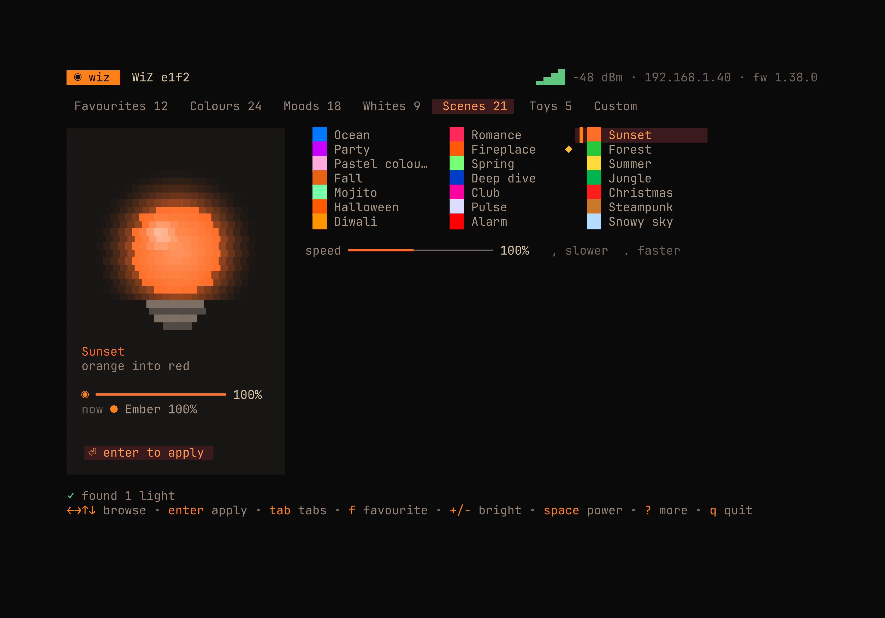
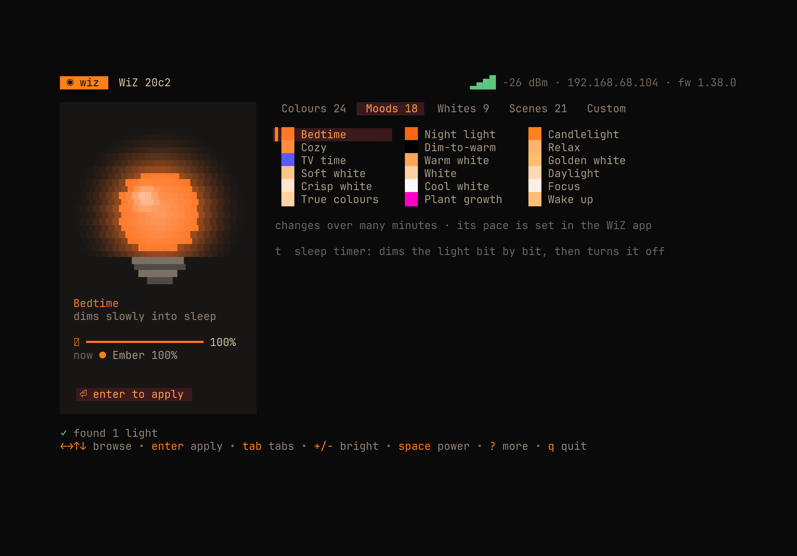
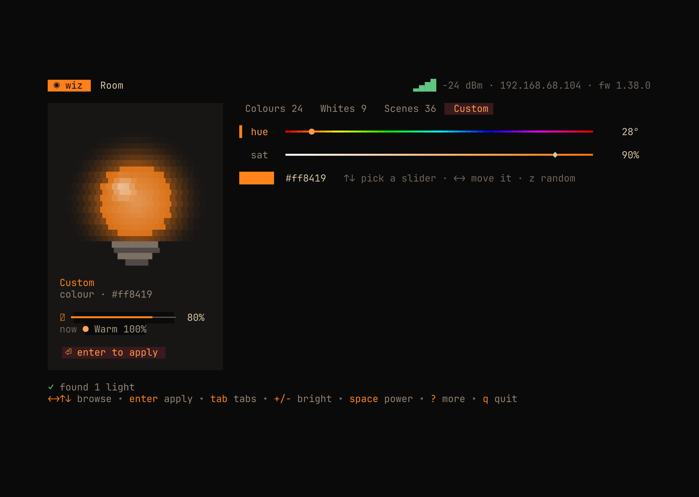

# wiz-tui

Control Philips WiZ lights from the terminal, over your own Wi-Fi. No cloud,
no account, no phone. Run `wiz` for an interactive screen, or `wiz red` for
one command that scripts, shortcuts and cron can call.

Built with [Bubble Tea](https://github.com/charmbracelet/bubbletea),
[Lip Gloss](https://github.com/charmbracelet/lipgloss) and
[Bubbles](https://github.com/charmbracelet/bubbles) v2.

## Install

```sh
go install github.com/parthshr370/wiz-tui/cmd/wiz@latest
```

Or from a checkout: `go build -o ~/.local/bin/wiz ./cmd/wiz`.

## One-time setup in the WiZ app

WiZ firmware 1.34 and later accepts local changes only when the app allows it.
Reading the light always works; changing it fails with `Invalid params` until
you pick one of these:

1. **All controls** (simplest). WiZ app: Settings, Security (under Current
   Home), Local communication, **All controls**. If it already says All
   controls and changes still fail, switch to "Only verified controls", save,
   switch back, save. The app can show the wrong value on 1.38.0
   ([home-assistant/core#177463](https://github.com/home-assistant/core/issues/177463)).
2. **Only verified controls** (stricter). Settings, Integrations, Local
   integrations, Get the link. Open the link within 15 minutes, copy the
   32-character `udp_signing_key`, and save it:

   ```sh
   mkdir -p ~/.config/wiz && printf '%s' 'KEY' > ~/.config/wiz/key && chmod 600 ~/.config/wiz/key
   ```

   `wiz` then signs every change (HMAC-SHA256 over the params, as in
   [this reference](https://gist.github.com/rmcolber/ccb5d804c36270efd1e1dfd239efe740)).
   The header shows `signed` when a key is loaded.

## The interactive screen



`wiz` opens a preset browser. Moving around only changes the glowing bulb on
the left, which eases to each colour as you land on it; **enter** sends it to
the light. The card shows what you are previewing, the brightness enter will
use, and what the light is doing **now**; the badge says `⏎ enter to apply`
until they match, then `✓ live`.

Five tabs, all wrapping, so you can just keep circling:

- **Colours**: 24, opening with the dark-hearth omp theme (Ember, Herdr red,
  Hearth gold, Aqua, Teal, Rose, Violet, Sea blue) then a full hue sweep.
- **Moods**: the WiZ app's own lights, warm to bright: Bedtime, Night light,
  Candlelight, Cozy, Dim-to-warm, Relax, TV time, Warm white, Golden white,
  Soft white, White, Daylight, Crisp white, Cool white, Focus, True colours,
  Plant growth and Wake up.
- **Whites**: Candle 2200 K up to Cool 6500 K.
- **Scenes**: the 21 animated colour scenes, each with a mood swatch. They
  make the preview bulb breathe, and `,` `.` set their speed.
- **Custom**: a rainbow hue slider and a saturation slider for any colour.



A few moods behave in their own way, and the screen says so:

- **Bedtime** and **Wake up** change over many minutes, on the bulb itself.
  Their pace is set in the WiZ app; nothing on the local network can change it.
- **Night light**, **Wake up** and **Alarm** set their own brightness, so
  `+`/`-` do nothing there.
- **Dim-to-warm** acts like an old bulb: lower brightness is warmer, from
  1800 K at 10% up to 4200 K at 90%, as the bulb reports it.
- **Soft white** (3500 K) and **Crisp white** (5000 K) are built-in scenes 38
  and 39. The WiZ app hides them, so the names are ours.

**Sleep timer.** `t` sets it to 15, 30 or 60 minutes, then off. Over that time
the light dims in steps to its lowest level, then turns off. It runs inside
`wiz`, so keep the screen open; `space` or turning the light off cancels it.



The preset the light is showing is marked `◉`. The screen re-reads the light
every 3 seconds, so a change from the phone app shows up too, and opening the
screen lands the cursor on whatever is live.

| Key | Does |
|---|---|
| `←` `→` / `h` `l`, mouse wheel | previous or next preset (Custom: move the slider) |
| `↑` `↓` / `k` `j` | row up or down (Custom: pick the slider) |
| `tab` / `shift+tab` | next or previous tab |
| `enter` | apply to the light |
| `+` / `-` | brightness, applied with the next enter |
| `,` / `.` | slower or faster animated scene |
| `space` | on or off, straight away |
| `esc` | jump back to what is live |
| `z` | surprise me: a random preset in this tab |
| `t` | sleep timer: 15, 30, 60 minutes, off |
| `b` | next light |
| `n` | name this light |
| `d` | scan the network again |
| `?` | all keys |
| `q` | quit |

## Commands

```text
wiz status [--json]          show the light's state
wiz on | off | toggle
wiz dim 40                   brightness 10-100
wiz warm | cool
wiz temp 4000                white at 4000 K
wiz red                      also orange amber yellow green teal blue purple pink
wiz color '#fe8019'
wiz scene fireplace 150      scene by name or id, optional speed 10-200
wiz scenes                   list scenes
wiz list                     scan and list every light
wiz name Desk lamp           name the selected light
wiz use desk                 make it the default
wiz -b 192.168.1.40 off      target one light by name, IP or MAC
```

Every change prints the light's state afterwards, for example
`Room (192.168.68.104): on, colour #ff0000, 100%`.

## How it works

WiZ lights listen for JSON on UDP port 38899. `getPilot` reads the state,
`setPilot` changes it, `getSystemConfig` and `getModelConfig` describe the
module, firmware, colour temperature range and minimum brightness.

Discovery sends `getPilot` to every address on each local /22 or smaller
network (many routers drop broadcast UDP) and keeps the ones that answer.
Lights are remembered by MAC in `~/.config/wiz/bulbs.json`, so a light that
gets a new IP from the router is found again by a rescan. Set
`WIZ_CONFIG_DIR` to keep state elsewhere.

Local control only works on the same network as the light. Away from home,
use the WiZ app.

## Layout

```text
cmd/wiz            CLI entry point; no command opens the TUI
internal/wiz       UDP protocol: requests, signing, discovery, scenes, colours
internal/config    ~/.config/wiz: signing key, remembered lights and names
internal/tui       Bubble Tea model, keys and view
```
